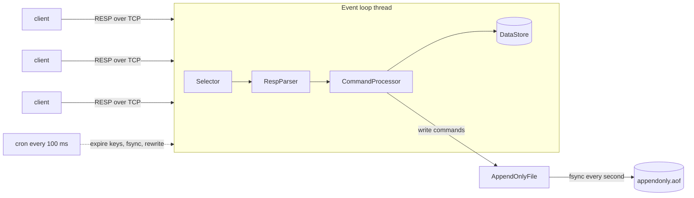

# mini-redis

[](https://github.com/digvijay165/java-projects/actions/workflows/mini-redis.yml)


A Redis-compatible key-value server written from scratch in plain Java, with no frameworks and no runtime dependencies.

It speaks RESP, the same wire protocol that `redis-cli` and Redis client libraries use. It serves many connections from a single thread, expires keys on time, and survives a crash without losing data.

```text
$ redis-cli -p 6379
127.0.0.1:6379> SET session abc123 EX 3600
OK
127.0.0.1:6379> RPUSH langs Java C++ Python
(integer) 3
127.0.0.1:6379> LRANGE langs 0 -1
1) "Java"
2) "C++"
3) "Python"
127.0.0.1:6379> TTL session
(integer) 3600
```

## Features

- **The Redis protocol (RESP2)** with pipelining, binary-safe values up to 512 MB, and inline commands for telnet
- **One event loop on Java NIO**, like Redis itself: every command is atomic with no locks
- **39 commands** for strings, lists, counters, key expiry and server info
- **Key expiry**, both lazy (on access) and active (Redis's random-sampling algorithm)
- **Append-only file persistence**, fsynced every second, with crash recovery and automatic compaction
- **Backpressure**: a client that doesn't read its replies can't use up the server's memory
- **A built-in benchmark tool** that also works against real Redis
- **68 JUnit tests**, including real TCP clients hammering the server at the same time

## Quick start

You need Java 21 or newer and Maven.

```bash
mvn package
```

```bash
java -jar target/mini-redis.jar
```

Then connect with `redis-cli`, any Redis client library, or plain telnet:

```bash
telnet 127.0.0.1 6379
```

| Option | Default | Meaning |
|---|---|---|
| `--port` | `6379` | Port to listen on |
| `--bind` | `127.0.0.1` | Address to listen on. There is no password, so keep it local. |
| `--aof <file>` | `appendonly.aof` | Where to persist data |
| `--no-aof` | | Keep data in memory only |

## How it works



### One thread, no locks

[`RedisServer`](src/main/java/io/github/digvijay165/miniredis/server/RedisServer.java) uses a Java NIO `Selector` to wait on every socket at once. When a socket has data, the loop reads it, parses every complete command in the buffer (a client can pipeline thousands at once), runs them in order and queues the replies. Only this one thread ever touches the data, so `INCR` from 20 clients at the same time always adds up exactly, with no locks. That's how Redis works too.

Each connection keeps its own input and output buffers ([`ByteQueue`](src/main/java/io/github/digvijay165/miniredis/server/ByteQueue.java)). A command can arrive one byte at a time and still be put back together. If a client stops reading its replies, the server stops reading from it once 64 MB of replies are waiting, so one slow client can't use up the memory.

### Parsing the protocol

[`RespParser`](src/main/java/io/github/digvijay165/miniredis/protocol/RespParser.java) doesn't remember anything between calls. You hand it the bytes received so far, and it returns the first complete command or `null` if it needs more bytes. Lengths are checked before anything is allocated, so a request that claims a 100 GB value is turned away at once.

### Key expiry

[`DataStore`](src/main/java/io/github/digvijay165/miniredis/store/DataStore.java) expires keys two ways, as Redis does:

- **Lazily:** reading an expired key deletes it first, so nobody ever sees one.
- **Actively:** every 100 ms, the server samples 20 random keys that have a TTL and deletes the expired ones. If more than a quarter of the sample had expired, many more probably have too, so it samples again (for at most 25 ms). Keys nobody ever reads again still free their memory.

To make sampling O(1), keys with a TTL are also kept in an array list, using swap-remove deletion.

### Persistence that survives a crash

[`AppendOnlyFile`](src/main/java/io/github/digvijay165/miniredis/persistence/AppendOnlyFile.java) logs every write command:

1. Commands are buffered, then written to the file **before** the replies are sent. A client never gets `OK` for a write the file hasn't received.
2. The file is fsynced every second, so a power cut loses at most about a second of writes.
3. Expiry times are saved as **absolute** times (`SET k v EX 10` is logged as `SET k v` + `PEXPIREAT k <time>`). After a restart a key keeps its original deadline instead of getting a fresh one.
4. A command cut off halfway by a crash is trimmed from the end of the file. Anything else that's invalid stops the start-up with the exact byte position, instead of quietly dropping data.
5. Once the file has doubled since its last rewrite (and is at least 64 MB), it's rewritten as the shortest set of commands that rebuilds the current data. The new file is fsynced and then atomically renamed over the old one.

I tested this by hard-killing the server process mid-run and restarting it: every key, list and TTL came back.

## Commands

| Group | Commands |
|---|---|
| Strings | `SET` (with `NX`, `XX`, `EX`, `PX`, `KEEPTTL`, `GET`), `GET`, `MSET`, `MGET`, `APPEND`, `STRLEN` |
| Counters | `INCR`, `DECR`, `INCRBY`, `DECRBY` (with overflow detection) |
| Lists | `LPUSH`, `RPUSH`, `LPOP`, `RPOP` (with a count), `LLEN`, `LRANGE` |
| Keys | `DEL`, `EXISTS`, `TYPE`, `KEYS` (glob patterns), `EXPIRE`, `PEXPIRE`, `EXPIREAT`, `PEXPIREAT`, `TTL`, `PTTL`, `PERSIST` |
| Server | `PING`, `ECHO`, `INFO`, `DBSIZE`, `FLUSHALL`, `FLUSHDB`, `SELECT 0`, `BGREWRITEAOF`, `QUIT` |
| Client compatibility | `COMMAND`, `CONFIG GET`, `CLIENT SETNAME/SETINFO/GETNAME` |

Error messages match Redis's own, for example `WRONGTYPE Operation against a key holding the wrong kind of value`.

## Benchmarks

The built-in tool works like `redis-benchmark`: many clients send requests at once while every round trip is timed.

```bash
java -jar target/mini-redis.jar bench --clients 50 --requests 200000 --pipeline 16
```

Results on my laptop (Windows 11, Java 25), with 50 clients, 200,000 requests, and the client and server on the same machine:

| Command | No pipelining | Pipeline of 16 |
|---|---:|---:|
| `PING` | 52,698 req/s | 533,699 req/s |
| `GET` | 43,673 req/s | 371,275 req/s |
| `SET` | 33,193 req/s | 320,229 req/s |
| `INCR` | 34,172 req/s | 334,697 req/s |
| `LPOP` | 35,478 req/s | 395,676 req/s |

Without pipelining, p50 latency was about 1 ms and p99 about 2–3.5 ms. Pipelining gives roughly 10× the throughput, because many commands share each network round trip.

## Tests

```bash
mvn verify
```

The 68 tests cover:

- **Protocol:** partial input byte by byte, pipelining, binary data, and seven kinds of malformed input
- **Commands:** every command, including edge cases such as strict integer parsing, overflow, `WRONGTYPE` and negative list indexes. A fake clock tests expiry to the exact millisecond.
- **Persistence:** restart, TTLs kept across restarts, a crash halfway through a write, a corrupted file, and rewrite
- **Server over real TCP:** 10,000 pipelined commands, a command sent one byte at a time, a 5 MB binary value, 20 clients incrementing one key at once, protocol errors, and `QUIT`

The build treats every compiler warning as an error.

## Project layout

```text
src/main/java/io/github/digvijay165/miniredis/
├── Main.java                  start-up and command-line options
├── server/                    NIO event loop, connection buffers
├── protocol/                  RESP parser, encoder and client-side reader
├── command/                   all 39 commands
├── store/                     keyspace, expiry, glob matching, lists
├── persistence/               append-only file
└── bench/                     load generator
```

## Limitations

- **AOF rewrite blocks the server.** Real Redis forks a child process to rewrite in the background. Here it runs on the event loop, which briefly pauses requests (about 150 ms for a 68 MB file).
- **Strings and lists only.** No hashes, sets, sorted sets or pub/sub yet.
- **No authentication or TLS**, which is why it listens on 127.0.0.1 by default.
- **One database** (`SELECT 0` only).

## What's next

- Hashes and sorted sets (with a skip list, like Redis)
- Background AOF rewrite on a second thread, using a copy-on-write snapshot
- Pub/sub
- Replication to a read-only follower
